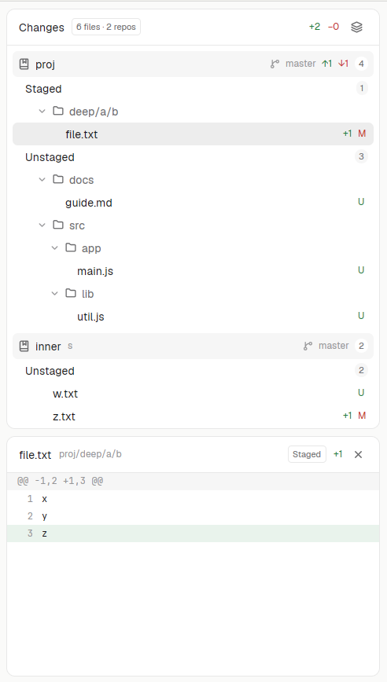

# Git Workbench for Herdr

A Changes panel for the [Herdr](https://herdr.dev) desktop app that shows
**several git repositories at once**, like a VS Code multi-root workspace.



- Each repository is its own section with its branch and its ↑ outgoing / ↓ incoming commits. Click the counts to sync (pull and push), like VS Code.
- Staged and unstaged files as a tree, with compact folders. Renames show as one row, like VS Code.
- Hover a file, a folder or a group to stage (+), unstage (−) or discard (↶) it. Discard asks first.
- Click a file to see its diff in the full panel, like the Files view; ← goes back. Stage, unstage or discard from there too.
- A History tab shows each repository's commits on a line, like VS Code's graph, with incoming and unpushed commits. Click a commit to see its files, and a file to see its diff.
- You choose the repositories for each project. The default is the repository of the focused terminal.

## Install

For Linux and macOS. It is not tested on Windows.

Give your agent in Herdr this link and ask it to add the mod:

```
https://github.com/iraklisg/herdr-git-workbench
```

Or copy `mods/git-workbench/` into `~/.config/herdr-app/mods/` and run
`herdr-app check ~/.config/herdr-app/mods/git-workbench`.

On the first start, Herdr docks the panel on the right of the window.
You can also open it as a pane or a tab.

### Use it as the right-side Changes panel

To replace the shipped Changes panel, clone the layout you use
(`herdr-app do layout.clone '{"name":"main","as":"my-main"}'`, or ask your agent),
then in `layouts/my-main.json` change the `changes` block to:

```json
{ "id": "changes", "type": "block", "content": { "mod": "git-workbench" } }
```

A cloned layout does not get Herdr's later changes to the original layout.

## Add repositories

Click the layers button in the panel header, then **Add folder…** and pick a
repository inside the project (or next to it). Click **Done**. The list is kept
per project in Herdr's shared state.

## What it runs

The mod runs `git` on your machine (status, diff, rev-parse, branch,
rev-list, add, restore, rm --cached and clean). It reads files only inside the selected repositories. It
uses the network only when you click to sync (`git pull`, `git push`). It does not fetch, so the ↑/↓ counts are
as of your last fetch.

## Build it yourself

[RECIPE.md](RECIPE.md) describes the mod in full, so an agent can build it
from scratch.

## License

Apache-2.0. Parts of `main.js` come from the `changes` mod shipped with
Herdr (Apache-2.0). The icons are from [Lucide](https://lucide.dev) (ISC, with
some icons under MIT from Feather): see
[mods/git-workbench/icons/LICENSE-Lucide.txt](mods/git-workbench/icons/LICENSE-Lucide.txt).
