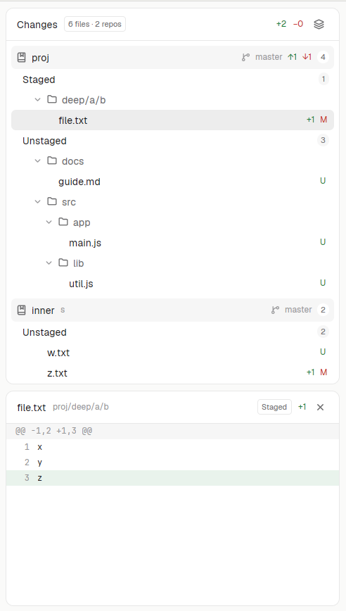

# Git Workbench

A Changes panel for projects that hold several git repositories, like a VS Code
multi-root workspace. You pick the repositories once per project. The panel then
shows each repository as its own section with its branch, its incoming and
outgoing commits, and its staged and unstaged files as a tree. Click a file to
see its diff in a second card below the list. Hover a file or folder to stage,
unstage or discard it.

## What you see

Two cards, top to bottom, 8px apart. Each card: radius 10px, 1px `theme().border`
border, `theme().background` fill, 13px text in `theme().foreground`.

**List card** (top):

- **Header**, 42px, 14px side padding, 1px bottom border: "Changes" (semibold);
  a badge "6 files · 2 repos" (10px, `muted`, 1px border, radius 4px, padding
  5px × 1px); free space; total `+N` in `ansi2` and `−N` in `ansi1` (11px);
  a 24px "layers" icon button (radius 6px) that opens the repository editor.
- **List**, 6px padding, scrolls with a vertical scrollbar. For each repository:
  - A 6px gap before every repository except the first.
  - **Repo band**, 30px, radius 6px, `raised` fill, 6px side padding, 6px gaps:
    a 14px book icon (`muted`); the repo folder name (semibold); a short path
    hint (11px, `dim`): the parent folders from the project root, each by its
    first letter (`p/w` for `packages/web/<name>`, `..` kept),
    empty for the project root; it fills the free space. Then a 12px
    git-branch icon and the branch (11px, `dim`, at most 140px, truncated);
    when ahead or behind, a sync button (radius 4px): a 12px Lucide
    refresh-cw icon, then `↑N` (`ansi2`) and `↓N` (`ansi1`) at 11px, each only
    when above zero. Its tooltip is "Pull N commits from origin/main" like
    VS Code, or "N commits to push to origin/main"; a click pulls when behind;
    a count badge (10px, `muted`, `background` fill, radius 8px).
    When space is short the hint gives way first, then the name.
  - "No changes" (12px, `dim`, 8px indent) when the repo has none.
  - **Group rows**, 26px: "Staged", then "Unstaged", in normal 13px
    `foreground` text, 8px indent, no chevron; a count badge on the right
    (10px, `muted`, `raised` fill, radius 8px). A group with no files is not shown.
  - **Tree rows**, 26px, indent 8px + 14px per level: folders have a 12px
    chevron, a 13px folder icon and the name in `muted`. A folder that holds
    only one folder shows as one row (`deep/a/b`). File rows have a 12px spacer,
    the file name (`dim` when deleted; a nested repo that is not in the list
    shows as `name/`), `+N`/`−N` (11px), and a 12px-wide status letter:
    `A` and `U` (untracked) in `ansi2`, `D` and `!` (conflict) in `ansi1`,
    `M` in `blocked`. The open file's row has the `selected` fill.
- An error note (11px, `ansi1`) under the list when an action fails.

**Diff card** (bottom), only while a file is open:

- **Header**, 42px, same padding and border as the list header: file name
  (semibold); repo path from the root plus the file's folders (11px, `dim`,
  truncated); a "Staged" or "Unstaged" badge like the files badge; `+N`/`−N`;
  a 20px × button.
- **Diff**: 20px rows in a virtual list, `settings().font_family` or
  JetBrains Mono at 11px, horizontal and vertical scroll. Hunk lines (`@@`)
  have the `raised` fill and `dim` text. Other rows: a 30px right-aligned line
  number in `dim`, 10px gap, the text. Added lines have `ansi2` + `18` alpha
  fill, removed lines `ansi1` + `18`.

With no file open, the list card fills the whole panel.

**Repository editor** (the layers button, shown in place of the list):
"Repositories in <root>" (12px, `muted`); the root with "project root";
each added repo by its path with a × button; an "Add folder…" button (only on
this computer) and a "Done" button (26px high, 1px border, radius 6px).

## How it behaves

- It shows no agent status. It follows the project of the focused terminal.
- **Project:** the longest saved project root that contains the focused
  terminal's folder; else that folder's git top level. A mod pane with the
  focus has no folder: the panel keeps the last terminal folder seen in that
  space, else uses the space folder.
- **Repositories:** the project root is always shown. More repos are added
  with the editor: "Add folder…" opens the system folder picker; the picked
  folder's git top level is saved relative to the root. Lists are kept per
  project (and per machine for remote spaces) in shared state.
- **Refresh:** on start, every 10 seconds, and when a watched repo changes.
  Folder watches work on this computer only, so remote projects refresh on the
  timer. A failed watch is tried again after a minute.
- **Clicks:** a repo band, group row or folder row opens or closes it. A file
  row opens its diff; clicking it again or × closes it. When nothing is
  closed by hand, the top file row of the tree opens by itself.
- **Hover** on a file, folder or group shows 20px buttons: on unstaged, a
  discard arrow (Lucide undo-2) and + (stages all files under it, conflicts
  left out); on staged, − (unstages).
- **Discard** asks first: a bar at the foot of the list card names the file,
  folder or group and the file count, warns that untracked files are deleted
  and that it cannot be undone, with Cancel and a red Discard. Conflicts and
  nested repos are left out, and the button does not show when nothing is left.
- **Hover** on the path hint shows the full path from the project root.
- **Drag** the 8px gap between the cards to resize them (resize cursor). The
  height is saved in shared state for all panels and restarts. The list keeps
  at least 100px and the diff card at least 202px.
- **Diffs:** staged files show `git diff --cached`, unstaged ones `git diff`,
  both with `--literal-pathspecs`. A conflicted file shows git's combined diff:
  `@@@` hunks with one marker column per parent. A line is red when any column
  has `-`, else green when any has `+`; lines without `-` get the new line number.
  Untracked files show their content as added lines. Binary files and nested
  repos show a one-line message.

## Built from

- One mod, `mods/git-workbench/`: `main.js`, `mod.json`
  (`{"place": "right", "size": 368}`), `icons/` (Lucide: book-marked,
  chevron-down, chevron-right, folder, git-branch, layers, minus, plus, refresh-cw, undo-2, x).
- gpui-kit: `View`, `div`, `svg`; gpui-base: `v_flex`, `h_flex`,
  `Scrollbar`, `v_virtual_list`. Element events: `on_click`, `on_hover`,
  `on_mouse_down`, `on_mouse_up`, `on_mouse_move`, `on_size_change`, `tooltip`.
- herdr: `spaces`, `panes`, `focused`, `exec`, `readTextFile`,
  `watchFolder`, `theme`, `settings`, `pickFolder`, `checking`,
  `shared`, `setShared`.
- Shared state keys: `git-workbench.projects` (`{ "<machine:>/abs/root":
  ["relative/repo", "../other"] }`) and `git-workbench.split` (px).
- Programs: `git` only. Reads use
  `git --no-optional-locks -c core.fsmonitor=false -c diff.autoRefreshIndex=false`:
  `status --porcelain=v1 -z --no-renames --untracked-files=all`,
  `rev-parse --verify -q HEAD`, `branch --show-current`,
  `diff [--cached] --numstat -z --no-renames`,
  `rev-list --left-right --count @{upstream}...HEAD`, `rev-parse --show-toplevel`.
  Actions use `git --literal-pathspecs`: `add -A -- <paths>`;
  `restore --staged -- <paths>`, or `rm --cached -f -q -r -- <paths>` when the
  repo has no commit yet; discard: `restore --worktree -- <tracked paths>`
  and `clean -f -q -- <untracked paths>`.
- It works in a layout block (for example in place of the shipped `changes`
  in the right panel stack) or as a pane or tab.

## Watch out

- Keep the repo list in `shared()`, not `localStorage`: Herdr runs several
  copies of a mod and each has its own `localStorage`, so copies disagree.
- Observed in herdr-app 0.1.16 (the gpui-kit docs say otherwise): `on_size_change`
  and mouse positions come in screen pixels, while `h()` and the other sizes are
  zoomed pixels. At zoom 1.1 the cards overflowed until both were divided by
  `settings().zoom`. Check this on your version before you copy it.
- gpui-base's `v_resizable` draws a divider line that cannot be styled. The
  drag handle here is a plain 8px div with mouse events. Mouse moves arrive
  only while the pointer is over the panel, so a drag also ends when it leaves.
- Before the first `on_size_change`, render the list card alone.
- A selected nested repo appears in its parent's status as an untracked
  folder. Drop entries inside other selected repos. Strip the trailing `/` of
  untracked folders and mark them as nested repos.
- `watchFolder` allows 64 watches. Watch only the outermost selected repos.
- In `init`, return early when `checking()` is true: `herdr-app check`
  must not run git.
- The ↑/↓ counts are as of the last fetch. The mod does not fetch.
- Pull runs `env GIT_TERMINAL_PROMPT=0 GIT_SSH_COMMAND="ssh -o BatchMode=yes" git pull`
  (2-minute timeout): there is no terminal for a password prompt, so a remote
  that needs one fails with git's message in the note bar. Git's own pull
  settings (merge, rebase, ff-only) apply.
- "Add folder…" uses `pickFolder`, which works only on this computer. For a
  remote space, the button is hidden.
- Paths are handled as `/`-separated, so it is built for Linux and macOS.
  It is not tested on Windows.
- At most 1,000 changed files per repo and 1,500 diff lines are shown. Lines
  over 4,000 characters are cut.

## Done when

- `herdr-app check mods/git-workbench` passes.
- In a repo with changes, the panel shows the repo band with its branch, and
  the Staged and Unstaged groups as trees with compact folders.
- After you add a nested repo with the layers button, it shows as its own
  section with a path hint, and it no longer shows as an untracked folder in
  its parent. The list stays after a restart.
- + on an unstaged file moves it to Staged; − moves it back.
- Discard on an unstaged file asks first; Cancel changes nothing, Discard
  returns a tracked file to its staged or committed state and deletes an
  untracked one. A file name with `[` or `*` affects only that file.
- A file click opens the diff card with the right diff; × closes it, and the
  list card fills the panel.
- Dragging the gap resizes the cards, and the height stays after a restart.
- A repo whose branch is behind its upstream shows `↓N` in `ansi1`; a
  click on it pulls, and the count goes away.
- At zoom 1.1, the diff card's bottom border is visible.
- During a merge conflict, the conflicted file's diff shows the conflict
  markers in green with line numbers from 1, and no marker columns in the text.
